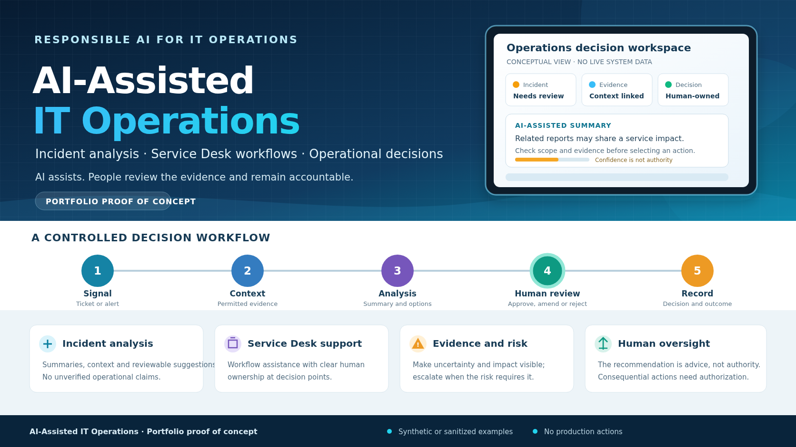

# AI-Assisted IT Operations

A portfolio proof of concept exploring how AI might assist IT Operations incident analysis and decision support while keeping evidence visible and people accountable.

> **Scope:** This is a runnable, read-only demonstration using fabricated cases and a transparent rules-based baseline. It is not an AI model or production service. It does not connect to ITSM, monitoring, identity, infrastructure, or AI-provider systems, and it does not execute operational actions.

## What it demonstrates

- Input validation for a small synthetic incident-case register.
- Explainable priority suggestions using explicitly supplied impact and urgency values.
- Evidence visibility and flagging of missing supporting context.
- CSV assessments, a JSON summary, and an unfilled human-review log template.
- Automated unit tests and a GitHub Actions workflow that runs both tests and the demo.

The current baseline does not interpret free-text narratives, correlate events, or call an AI model. It demonstrates a reviewable workflow—not AI accuracy, operational impact, or production readiness.

## Quick start

Requires Python 3.10+; no third-party packages are needed.

```bash
python -m venv .venv
# Windows PowerShell:
.venv\\Scripts\\Activate.ps1
# macOS/Linux:
# source .venv/bin/activate

python -m unittest discover -v
python -m opsassist.cli --input data/cases.csv --output-dir reports
```

The command creates:

- `reports/case_assessments.csv` — each case's suggested priority, evidence, missing context, and review/action flags.
- `reports/executive_summary.json` — totals, priority counts, assessment method, and limitations.
- `reports/review_log_template.csv` — blank fields for a human to record a later review; the program does not approve or execute anything.

Generated reports are ignored by Git. Use synthetic examples only; output reports repeat the text supplied in the input CSV.

## Example run

The bundled dataset contains seven fabricated cases. Local execution produced:

```text
Cases assessed: 7
Assessment method: transparent rules baseline (not an AI model)
Human review required: yes; no actions are executed
Priority counts: P1=1, P2=3, P3=1, P4=2
Actions executed: 0
```

These counts demonstrate program behavior only; they are not accuracy or service-performance results.

## Scoring approach

The score is an **illustrative review-priority suggestion**, not a probability of failure, an organizational severity policy, or a calibrated risk model. The rules use the declared impact and urgency fields; they do not infer these values from the case narrative.

| Impact / urgency | high | medium | low |
|---|---|---|---|
| high | P1 | P2 | P2 |
| medium | P2 | P3 | P4 |
| low | P2 | P4 | P4 |

Every suggestion requires human review. P1/P2 records prompt an incident or operations lead to review; P3/P4 records prompt analyst triage. Missing evidence is flagged, not invented. The complete rule notes are in [`docs/SCORING_MODEL.md`](docs/SCORING_MODEL.md).

## Case workflow

```text
Synthetic case → Validate declared fields → Apply transparent rules
             → Present evidence and suggestion → Human review
             → Record a decision separately (no action execution)
```

The blank review template is not evidence that a human review has occurred. The tool has no remediation code or live-system connector.

## Data dictionary

| Field | Description |
|---|---|
| `case_id` | Unique synthetic case identifier |
| `created_at` | Example timestamp, retained as text; no time analysis is performed |
| `service` | Synthetic service label |
| `summary` | Short description; the baseline does not interpret the text |
| `impact`, `urgency` | Required values: `low`, `medium`, or `high` |
| `evidence` | Synthetic evidence note; a blank value is flagged as missing context |

The loader also rejects missing required columns, empty input, invalid values, blank required fields, and duplicate case IDs. See [`docs/DATA_DICTIONARY.md`](docs/DATA_DICTIONARY.md) for input and output details.

## Governance principles

1. Use only fabricated examples; do not commit confidential employer, customer, personal, credential, or production data.
2. Keep supplied evidence distinct from derived priority suggestions.
3. Require human review for every case; do not treat a suggestion as approval.
4. Escalate high-impact, uncertain, or evidence-poor cases rather than filling gaps with assumptions.
5. Do not use this demonstration to make live service decisions or execute changes.
6. Define a reviewed evaluation set, data boundary, and approval process before considering any model or integration.

See [`docs/OPERATING_MODEL.md`](docs/OPERATING_MODEL.md) for proposed roles, controls, and evaluation measures.

## Repository structure

```text
.
├── data/cases.csv
├── docs/
│   ├── DATA_DICTIONARY.md
│   ├── OPERATING_MODEL.md
│   ├── SCORING_MODEL.md
│   ├── LINKEDIN_ARTICLE.md
│   ├── LINKEDIN_SHORT_POST.md
│   ├── LINKEDIN_GROUPS_POST.md
│   ├── LINKEDIN_NETWORK_BLURB.md
│   └── images/ai-assisted-it-operations-banner.png
├── opsassist/
│   ├── assessment.py
│   ├── cli.py
│   └── io.py
├── reports/                     # generated locally by the CLI
├── tests/test_assessment.py
├── .github/workflows/tests.yml
├── .gitignore
└── README.md
```

## Roadmap

- Define an analyst-reviewed evaluation set and measures for evidence fidelity, missing context, and override behavior.
- Assess whether a narrowly scoped AI model adds value beyond the transparent rules baseline.
- If justified, document approved data handling and model/provider controls before implementing a model adapter.
- Consider read-only integrations only after scope, authorization, privacy, and evaluation requirements are agreed.
- Keep live action execution outside this proof of concept unless a separately approved design establishes policy gates and audit controls.

## Related article

[AI-Assisted IT Operations: Keeping Human Judgment in the Loop](docs/LINKEDIN_ARTICLE.md) is a draft in this repository and has not been published on LinkedIn. Promotional drafts are kept as separate files under `docs/`.

## Disclaimer

All bundled cases and evidence are fictional. This proof of concept is deterministic and read-only; it offers suggestions for human review and does not establish production suitability, measured accuracy, or operational benefit.
